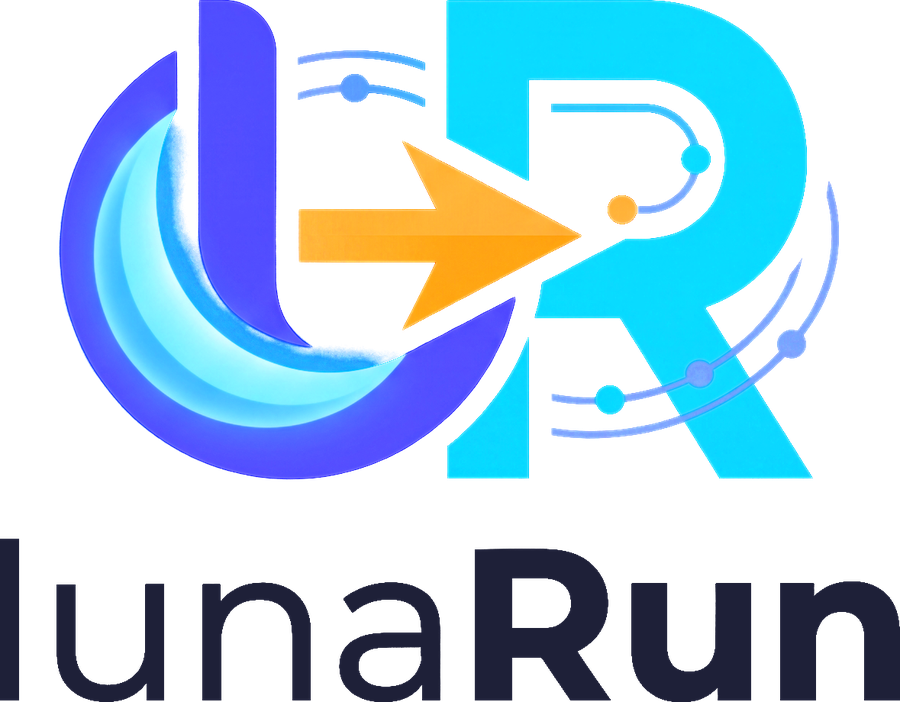

<h1 align="center">
  <picture>
    <source media="(prefers-color-scheme: dark)" srcset="assets/logo-lockup-dark.png">
    
  </picture>
</h1>

<p align="center">
  <strong>Run every PHP, Node.js and database version you need, side by side.</strong><br>
  A free, open-source local development environment for PHP &amp; Laravel on Windows, macOS and Linux.
</p>

<p align="center">
  <a href="https://github.com/userAshwani/lunaRun/releases/latest"></a>
  <a href="https://github.com/userAshwani/lunaRun/releases"></a>
  <a href="https://github.com/userAshwani/lunaRun/actions/workflows/ci.yml"></a>
  <a href="LICENSE"></a>
  
</p>

<p align="center">
  <a href="#download">Download</a> ·
  <a href="#why-lunarun">Why lunaRun</a> ·
  <a href="#documentation">Documentation</a> ·
  <a href="#development">Development</a>
</p>

---

## Download

The links below always point to the **newest release**, so they never need updating. Every release is built
automatically by GitHub Actions from a version tag.

| Platform | Download |
|---|---|
| **Windows** 10 / 11 (64-bit) | [**lunaRun for Windows** (.exe installer)](https://github.com/userAshwani/lunaRun/releases/latest/download/lunaRun-windows-x64-setup.exe) · [.msi](https://github.com/userAshwani/lunaRun/releases/latest/download/lunaRun-windows-x64.msi) |
| **macOS** 12+ (Apple silicon and Intel) | [**lunaRun for macOS** (.dmg)](https://github.com/userAshwani/lunaRun/releases/latest/download/lunaRun-macos-universal.dmg) |
| **Linux** (64-bit) | [AppImage](https://github.com/userAshwani/lunaRun/releases/latest/download/lunaRun-linux-x64.AppImage) · [.deb](https://github.com/userAshwani/lunaRun/releases/latest/download/lunaRun-linux-x64.deb) · [.rpm](https://github.com/userAshwani/lunaRun/releases/latest/download/lunaRun-linux-x64.rpm) |

All versions and their change notes are on the [Releases page](https://github.com/userAshwani/lunaRun/releases).

<details>
<summary><strong>First-run notes: the installers are not code-signed yet</strong></summary>

- **Windows:** the installer is per-user and needs no administrator rights. SmartScreen may say "Windows protected
  your PC": choose **More info**, then **Run anyway**.
- **macOS:** Gatekeeper blocks unsigned apps. Right-click the app and choose **Open**, or run
  `xattr -dr com.apple.quarantine /Applications/lunaRun.app` once.
- **Linux:** make the AppImage executable first: `chmod +x lunaRun-linux-x64.AppImage`.

</details>

> **Status: pre-alpha.** The app runs and shows system diagnostics, but installing runtimes, running services and
> project detection are still being built. See the [roadmap](docs/ROADMAP.md) for what exists today.

## Why lunaRun?

Classic stacks (XAMPP, WAMP, MAMP) give you **one** PHP and **one** MySQL. Real life is different:
one client is still on Laravel 9 / PHP 8.1, a new project is on Laravel 13 / PHP 8.4, and an old
WordPress site needs MySQL 5.7.

lunaRun lets you:

- **Install many versions** of each runtime (PHP 7.4 → 8.5, MySQL 8.0 / 8.4 / 9.x, MariaDB, Node LTS lines…) and keep them all.
- **Run them at the same time** — PHP 8.1 for one site and PHP 8.4 for another, simultaneously.
- **Point it at a project folder** — it reads `composer.json`, `composer.lock`, `package.json`,
  `.nvmrc`, `.env` and recommends (or downloads) the versions that project needs.
- **One click** to start the project's site, database and open a terminal with the right `php`, `composer` and `node` on the `PATH`.

## Platforms

| Platform | Status |
|---|---|
| Windows 10/11 (x64) | Primary target |
| macOS 12+ (Apple Silicon & Intel) | Primary target |
| Linux (x64, AppImage / .deb / .rpm) | Best effort |

## Documentation

| Doc | What's inside |
|---|---|
| [docs/PRD.md](docs/PRD.md) | Product requirements — what we build and why |
| [docs/ARCHITECTURE.md](docs/ARCHITECTURE.md) | Tech stack, components, data model, IPC |
| [docs/RUNTIMES.md](docs/RUNTIMES.md) | Where binaries come from, registry format, install flow |
| [docs/PROJECT-DETECTION.md](docs/PROJECT-DETECTION.md) | How project requirements are detected and resolved |
| [docs/SERVICES.md](docs/SERVICES.md) | Process supervision, ports, config templates |
| [docs/BUILD-AND-RELEASE.md](docs/BUILD-AND-RELEASE.md) | CI, release pipeline, signing, auto-update |
| [docs/ROADMAP.md](docs/ROADMAP.md) | Phased task list |
| [docs/DECISIONS.md](docs/DECISIONS.md) | Architecture decision log |
| [docs/REPO-SETUP.md](docs/REPO-SETUP.md) | Maintainer guide: GitHub setup |

## Development

You need [Rust](https://rustup.rs), Node.js 24 LTS and [pnpm](https://pnpm.io), plus the
[Tauri prerequisites](https://v2.tauri.app/start/prerequisites/) for your OS. See [CONTRIBUTING.md](CONTRIBUTING.md).

```bash
pnpm install
pnpm tauri dev      # run the app
pnpm test           # frontend tests
cargo test --workspace
```

## License

[Apache License 2.0](LICENSE).

lunaRun does **not** bundle PHP, MySQL, MariaDB, Node.js or other runtimes. It downloads them on
your request from their official (or documented) sources, and each one keeps its own license.
See [docs/RUNTIMES.md](docs/RUNTIMES.md#licensing).

*lunaRun is not affiliated with Apache Friends (XAMPP), WampServer, Laravel, Oracle (MySQL) or the
MariaDB Foundation. Product names are used only to describe compatibility.*
